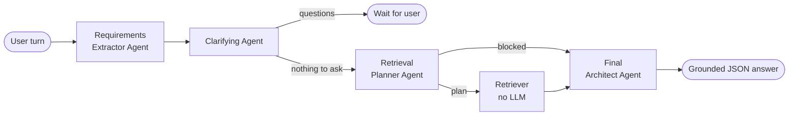

# AI Architect 🤖🧠

A **multi-agent AI system** that helps users design **GPU infrastructure, model choices, and Kubernetes-based architectures** for AI/ML workloads.

It behaves like an AI solutions architect: it extracts structured requirements, asks only the clarifying questions it needs, plans what evidence to retrieve, and produces a recommendation whose GPUs, prices and Kubernetes components are checked against that evidence in code.

---

## Architecture

Four LLM agents and one deterministic executor, orchestrated with LangGraph:



| Node | LLM? | What it decides |
|---|---|---|
| **Requirements Extractor** | yes | Turns the conversation into a structured `requirements` object. Never guesses: unstated fields stay `unknown`. |
| **Clarifying Agent** | yes | Which missing fields to ask about this turn, and how to phrase the questions (max 3 per turn). |
| **Retrieval Planner** | yes | Which knowledge bases to query, with what query text and filters (e.g. minimum VRAM sized from the workload). |
| **Retriever** | no | Executes the planner's plan against the tools. Makes no decisions of its own. |
| **Final Architect** | yes | Writes the recommendation, deployment plan, cost estimate and Mermaid diagram from the evidence. |

### What is decided by the LLM, and what is enforced in code

The agents make the judgement calls; code enforces the guarantees.

- **Gating:** the list of missing critical fields is computed in code, not taken from the model. No tool is called while any critical field is unknown.
- **Merge guard:** a value the user already gave is never overwritten by `unknown`.
- **Question budget:** after `MAX_CLARIFY_ROUNDS` the system stops asking and reports what is missing.
- **Grounding:** every recommended GPU instance and Kubernetes component must appear in tool evidence, otherwise it is dropped. GPU type, count, VRAM and hourly price are copied from the evidence rows, overwriting whatever the model wrote.
- **Honest model recommendations:** a model found by the Hugging Face tool keeps its evidence licence; any other is labelled `expert baseline / estimate (not tool-verified)`.
- **Blocked answers:** with no GPU or component evidence the final LLM is not called at all, and a `ready_to_answer: false` response explains why.
- **Schema validation:** every agent output is validated against a JSON Schema; on failure the error is fed back to the model for a bounded number of repair attempts.

---

## Project layout

```
ai_architect/
  agents/          extractor, clarifier, planner, retriever, final
  prompts/         one system prompt per agent
  schemas/         JSON Schemas for every agent output
  graph.py         LangGraph wiring
  routing.py       conditional-edge functions
  state.py         shared state, critical fields, merge logic
  llm_json.py      schema-validated LLM calls with repair retries
  tools.py         cloud GPU pricing, Kubernetes packages, Hugging Face search
  config.py        environment-based configuration
  runner.py        run_agent() entry point and CLI
tests/             agent and routing tests (scripted LLM, stubbed tools)
```

---

## Setup

```bash
pip install -r requirements.txt
cp .env.example .env      # then fill in the keys and DATABASE_URL
python -m ai_architect.runner
```

Configuration is read from environment variables:

| Variable | Purpose |
|---|---|
| `LLM_PROVIDER` | `mistral` (default) or `openai` |
| `MISTRAL_API_KEY` / `OPENAI_API_KEY` | key for the selected provider |
| `MISTRAL_MODEL` / `OPENAI_MODEL` | model name |
| `DATABASE_URL` | Postgres with pgvector, holding `cloud.instances` and `cloud.bitnami_packages` |
| `MAX_CLARIFY_ROUNDS` | clarification turns before giving up (default 3) |

The retrieval tools need that database; it is not included in this repository. Without it the system still runs and returns a blocked answer naming the missing evidence.

## Tests

```bash
pytest
```

The tests need no API key or database. They drive the agents with a scripted LLM and stubbed tools and check the clarify-then-answer flow, the planner-to-tool argument passing, the grounding rules and the blocked paths.

---

## Example use cases

* "I have 2TB of medical MRI data and want to fine-tune a segmentation model"
* "Recommend GPUs and Kubernetes setup for LLM fine-tuning"
* "Design a compliant AI pipeline for sensitive data in the EU"

---

## Limitations

* Tool calls in a plan run sequentially, and the planner gets one pass: it does not re-plan after seeing weak evidence.
* VRAM per instance is derived heuristically from the pricing feed (per-GPU vs total).
* Model recommendations outside Hugging Face search results are expert estimates, labelled as such.
* Outputs are for research and planning; nothing here is a clinical or regulatory approval.

---

## Author

Built by **Mojdeh Ghadami**
MSc Artificial Intelligence & Data Science
Focus: Agentic AI systems, LLM orchestration, AI infrastructure design
